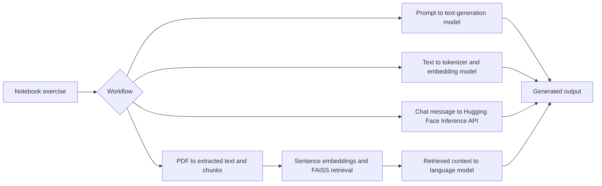

# Generative AI and Agentic AI Tutorials

**Notebook exercises in text generation, language models, chat assistants, and document Q&A.**

## Overview

This repository contains four Jupyter notebooks that explore transformer text generation, tokenization and embeddings, a Hugging Face-powered placement assistant, and a retrieval-augmented question-answering workflow over uploaded PDFs.

## Key features

- Generate text with GPT-2 and experiment with decoding parameters.
- Inspect GPT-2 tokens and compare sentence embeddings.
- Build a Gradio chat interface for a college placement and career assistant using a Hugging Face Inference API.
- Extract PDF text, retrieve relevant chunks with FAISS, and generate contextual answers with a local language model.

## Tech stack

Python, Jupyter Notebook, Hugging Face Transformers, Hugging Face Hub, Sentence Transformers, FAISS, PyTorch, pypdf, scikit-learn, NumPy, pandas, and Gradio.

## Architecture and workflow



## Project structure

```text
.
├── GenAI_Tutorials1.ipynb   # GPT-2 text generation
├── GenAI_Tutorial_2.ipynb   # Tokenization and embeddings
├── GenAI_Chatbot_T3.ipynb   # Placement assistant chatbot
└── PDF_RAG_System.ipynb     # PDF retrieval-augmented Q&A
```

## Installation and execution

Create a Python environment, install the notebook dependencies, and launch Jupyter:

```bash
python -m venv .venv
# Activate the environment for your shell, then:
python -m pip install jupyter transformers sentence-transformers scikit-learn huggingface_hub gradio pypdf faiss-cpu torch pandas numpy
jupyter notebook
```

Run the selected notebook cells in order. The chatbot notebook requires a Hugging Face access token for its configured inference provider. The PDF notebook uses a file-upload flow in Google Colab; model and embedding downloads require network access.

## Author

**Gireesh Sadanand Patgar** · [GitHub](https://github.com/gireeshpatgar17)